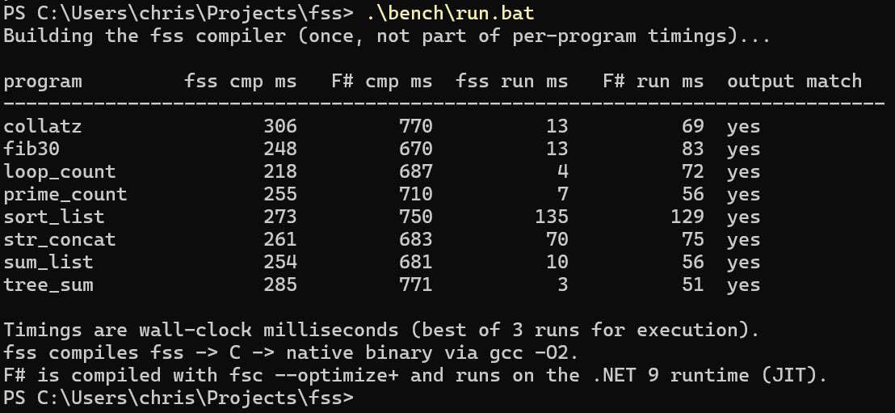

# fss — an F# subset compiled to C

A small compiler that lowers an F#-like source language to C, then uses the
system C compiler to produce a native executable (libraries come later).



Read `DESIGN.md` for the full design: what is kept, converted, reimplemented,
and dropped, plus the value-representation and memory-model decisions.

> **Work in progress.** This is an early, incomplete implementation (v0.2).
> The language surface, runtime, and self-hosting bootstrap are still
> evolving, so expect rough edges and breaking changes.

## Status

Implemented so far (v0.2):

- lexer, parser, type checker (Hindley-Milner-style unification), C codegen, gcc driver
- `int` (32-bit), `bool`, `unit`, function types `t -> u`
- arithmetic `+ - * / %`, comparison `= <> < <= > >=`, logic `&& || not`, negation `-`
- `if / then / else` (statement and expression), `if / then` (unit if), `while / do`
- `let ... in ...`, `let mutable ... in ...`, `<-`
- functions: `let f x y = ...`, `let rec f x = ...`, lambdas `fun x -> ...`, application `f x`
- closures (capture by value; mutable captures by reference), partial application
- direct-call optimization for fully applied top-level functions; tail-position
  `return`s so gcc performs sibling-call optimization on self-recursion
- records (`type R = { X: int; Y: int }`, `r.X`, `{ r with X = 1 }`)
- discriminated unions (`type T = A of int | B of int * int | C`), constructors, matching
- options (`None`, `Some x`), lists (`[]`, `x :: xs`, `[1; 2]`), tuples `(1, 2)`
- `match ... with | pat -> ... | ...` with wildcard/variable/literal/tuple/union/list patterns
- structural equality (`=`, `<>`) for all data types (including strings)
- UTF-8 strings: literals, `+` concatenation, `=`, `str_len`, `print_string`
- formatting helpers: `int_to_string`, `bool_to_string` (build strings with `+`)
- I/O: `read_line ()` (stdin), `read_file path`, `write_file path content`
- exceptions: `failwith "msg"`, `try e with | pat -> ...` (`_`, variable, or string literal)
- `let main argv = ...` gives `argv : string list` (also `let main () = ...`)
- `;` sequencing, scope-correct shadowing
- **significant whitespace**: newline + indentation is accepted as an
  alternative to `;`/`in`/`( )`, so F#-style layout just works
- F# attributes (`[<EntryPoint>]`, etc.) are read and ignored
- `open System` and `.NET`-style names (`System.Console.WriteLine`,
  `System.String`, `Console.WriteLine`, ...) are aliased to fss builtins/types
- `fss scan file.fs` reports F# features fss doesn't support (instead of a
  hard compile failure)
- builtins: `print_int`, `print_bool`, `print_newline`, `print_string`, `str_len`,
  `int_to_string`, `bool_to_string`, `read_line`, `read_file`, `write_file`

Not yet: arrays, type annotations, local `let rec` and `and`, full `sprintf`,
`try/finally`, `raise`. These are the next milestones in `DESIGN.md`.

Top-level mutual recursion is supported: `let rec even n = … and odd n = …`.

### v0.2 limitations

- Top-level bindings are polymorphic (Hindley-Milner let-polymorphism) and
  monomorphized per use. Local `let` bindings stay monomorphic — hoist them to
  top level if you need polymorphism.
- Local `let rec` is rejected; define recursive functions at top level.
- A top-level function can be *applied* but not passed as a value
  (`let g = f` is rejected); use a lambda instead: `let g = fun x -> f x`.
- User-defined record/union types are **heap-allocated** (pointer-boxed), so
  recursive types like `type Tree = Leaf of int | Node of Tree * Tree` work.
- Strings are UTF-8 with a length prefix; `str_len` returns the byte length.
- Heap memory is reclaimed by a small conservative mark-sweep garbage
  collector (stack + registered-global roots), triggered at a 16 MB threshold.

## Build the compiler

```sh
dotnet build src/Fss.fsproj -c Release
```

### Native (AOT) compiler — recommended

A one-time publish turns the compiler itself into a native binary, removing
.NET startup from every compilation (minimal compile time):

```sh
bash scripts/build-native.sh     # produces build/aot/fss.exe
./build/aot/fss.exe build prog.fs -o prog
```

The managed build (`dotnet run ...` or `dotnet src/bin/Release/net9.0/fss.dll`)
still works and is what the bootstrap uses.

## Use

```sh
fss build prog.fs -o prog          # compiles to prog.exe (Windows) or prog
fss build a.fs b.fs -o app         # multiple files are merged in order
fss scan prog.fs                   # list unsupported F# features
./prog
```

Flags:

- `-o <output>` — output base name
- `--keep-c` — keep the generated `prog.c`
- `-O0` / `-O1` / `-O2` / `-O3` / `-Os` / `-Ofast` — C optimization (default `-O2`)
- `--cc <name>` — C compiler (default `cc`)
- `--march-native` — add `-march=native` for maximum local performance

`-fwrapv` is always passed: F# `int` arithmetic is unchecked and wraps, while C
signed overflow would otherwise be undefined behaviour.

## Syntax notes (small deviations from F#, for now)

Both the verbose form (`;`, `in`, `( ... )`) and F#-style layout work:

```fsharp
// verbose
print_int 1; print_newline ()
let x = 1 in print_int x

// significant whitespace
print_int 1
print_newline ()
let x = 1
print_int x
```

- A `while`/`if`/`let`/function body is a *single statement*; in the verbose
  form use `( ... )` for several, or indent a block in the layout form
- Functions: `let add x y = x + y`, `let rec fact n = if n = 0 then 1 else n * fact (n - 1)`
- Lambdas: `fun x -> x + 1`; application: `f x y`

## Test

```sh
bash tests/run.sh
```

Runs positive cases under `tests/cases/` (compile, run, diff expected output)
and negative cases under `tests/errors/` (must fail with a type error), plus
bootstrap and self-hosting round-trip checks (300+ cases total).

## Benchmark vs F#

`bench/` contains the same small programs written in both fss and F#, with a
script that times compilation and execution of each.

```sh
bash bench/run.sh
```

See `bench/README.md` for the current numbers and the takeaways (compile time,
run time, and where allocation-heavy code behaves differently).

## Self-hosting goal

The .NET compiler is a bootstrap seed. The end goal is to rewrite the compiler
in the fss subset and compile it with itself, removing .NET from the toolchain
entirely. The compiler core is kept free of reflection and `%A`/`%d` printf for
that reason.

Bootstrap stages done, all written in fss, compiled by fss, and exercised by
the test suite:

- `bootstrap/lexer.fs` — tokenizer
- `bootstrap/parser.fs` — precedence-climbing parser (recursive `Expr` AST)
- `bootstrap/typer.fs` — unification-based type checker
- `bootstrap/compiler.fs` — emits a complete C program from a typed AST,
  with top-level `let`/`let rec` (incl. `and` groups), Hindley-Milner
  let-polymorphism + monomorphization, functions/closures, options, mutable
  globals + assignment, n-ary tuples, lists + pattern matching, union/record
  types, structural equality for `=`/`<>` on all data types, and the builtin
  runtime (string ops, I/O, `failwith`) (fss → C → gcc → binary). It now
  compiles `bootstrap/lexer.fs`, `bootstrap/parser.fs`, and
  `bootstrap/typer.fs` to native binaries whose output matches the .NET-built
  versions byte-for-byte, and it compiles **itself**
  (`bootstrap/compiler.fs`) to a working native binary (self-hosting
  milestone).

To support them, `elif`, `str_get`, `str_sub`, `int_of_string`, recursive
(pointer-boxed) user types, and top-level `let mutable` were added. The
self-hosted compiler also handles F# attributes (`[<EntryPoint>]`, ignored),
`open System` + dotted `.NET` names (`Console.WriteLine`, `System.String`,
`System.IO.File.ReadAllText`, …), type annotations (`(name: T)`, ignored), and
`let main () = …`. Significant whitespace in the self-hosted compiler is the
remaining gap (it still wants `in` for local lets).

Known limitation: the .NET NativeAOT compiler binary hits a NativeAOT edge case
on a few code shapes (recursive function + option + `if`), so it may not compile
`bootstrap/parser.fs`; the managed compiler (`dotnet fss.dll`) handles it, and
the test suite uses the managed compiler. The AOT binary is a bootstrap-only
optimization and will be retired once self-hosting is complete.

## Acknowledgements

Developed with [Pi](https://pi.dev), an extensible open-source coding-agent
harness, running on the [DeepSeek Platform](https://platform.deepseek.com).

## License

MIT — see `LICENSE`.
